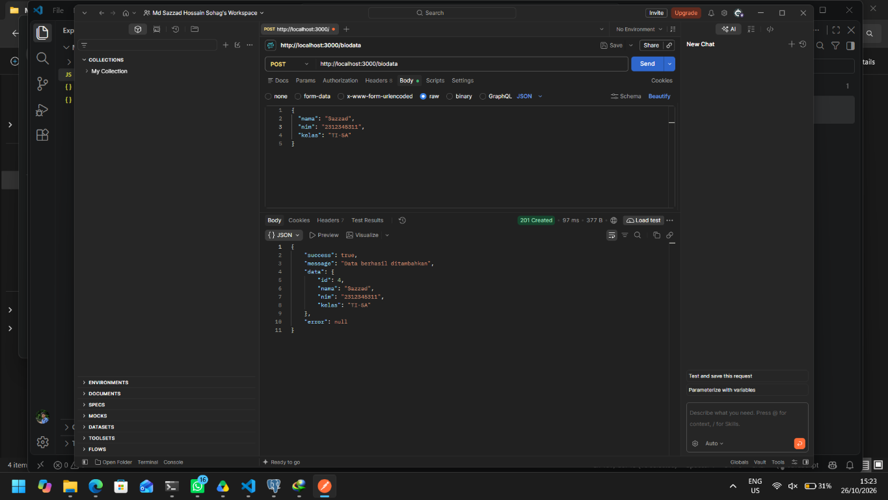

# Smart Student Resource Recommender (SSR)

Week 7 foundation for a web application that will help students discover learning resources. This version uses fictional temporary sample data only. It does not connect to a database or implement the recommendation algorithm yet.

## Requirements

- Node.js 18 or newer
- npm

## Setup

1. Install dependencies:

   ```bash
   npm install
   ```

2. (Optional) Copy `.env.example` to `.env` and set `PORT`.

3. Start the development server:

   ```bash
   npm run dev
   ```

4. Open [http://localhost:3000](http://localhost:3000) in a browser.

## Frontend pages

- `/` - Dashboard home page with search shortcuts and onboarding steps.
- `/resources` - Resource discovery page. It loads the existing sample API data and filters it in the browser.
- `/history` - Browser-only search history with search-again and delete controls.

Search history is stored in `localStorage` under the current browser only. The Study Assistant button is a frontend-only placeholder because no chatbot backend is connected.

## API endpoints

### `GET /api/status`

Returns the service health status:

```json
{
  "status": "ok",
  "message": "SSR API is running"
}
```

### `GET /api/produk`

Returns five fictional, temporary learning-resource objects. Each object includes `id`, `title`, `description`, `subject`, `difficulty`, and `url`.

### `POST /api/recommendations`

Ranks the current temporary resource catalog using up to 20 recent browser searches. Search history is sent for ranking only and is never saved by the server.

Request:

```json
{
  "history": [
    {
      "subject": "Programming",
      "keyword": "JavaScript",
      "difficulty": "Intermediate",
      "createdAt": "2026-10-26T06:00:00.000Z"
    }
  ]
}
```

The response contains `status`, `personalized`, `source`, and a `recommendations` array. With empty history, the endpoint returns beginner-friendly fallback resources. The current Week 7 project has no PostgreSQL resource repository or TF-IDF service yet, so `source` is `temporary-sample-data`.

## Project structure

```text
config/                 Configuration modules
models/                 Future data models
middlewares/            Request logger and centralized error handler
controllers/            Web and API controller logic
routes/                 Web and API route definitions
views/                  EJS server-rendered pages and partials
utils/                  Future shared utilities
public/css/             Stylesheets
public/js/              Browser JavaScript
public/images/          Image assets
app.js                  Express application entry point
```

## Available command

- `npm run dev` - Start the server with Nodemon for development.

## API demonstration

The following screenshot shows a successful `POST /biodata` request and JSON response in Postman:


